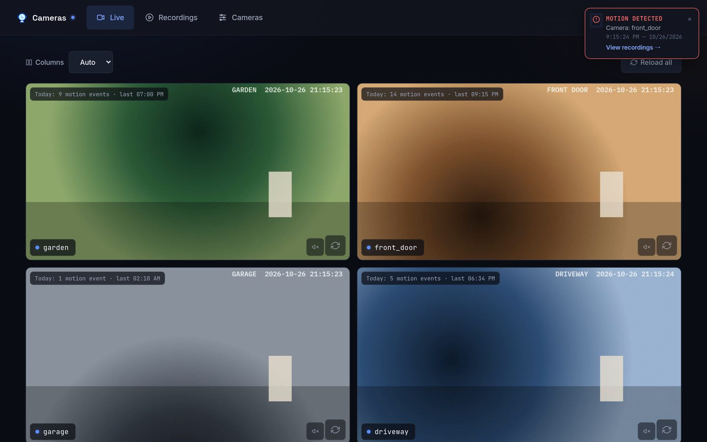
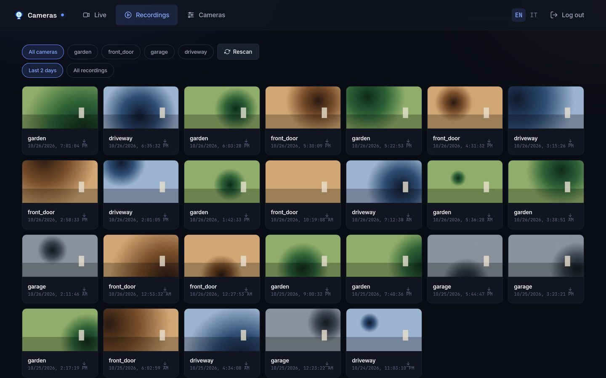
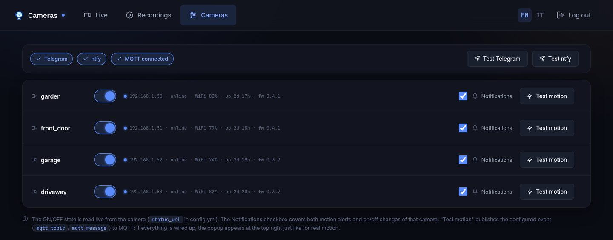
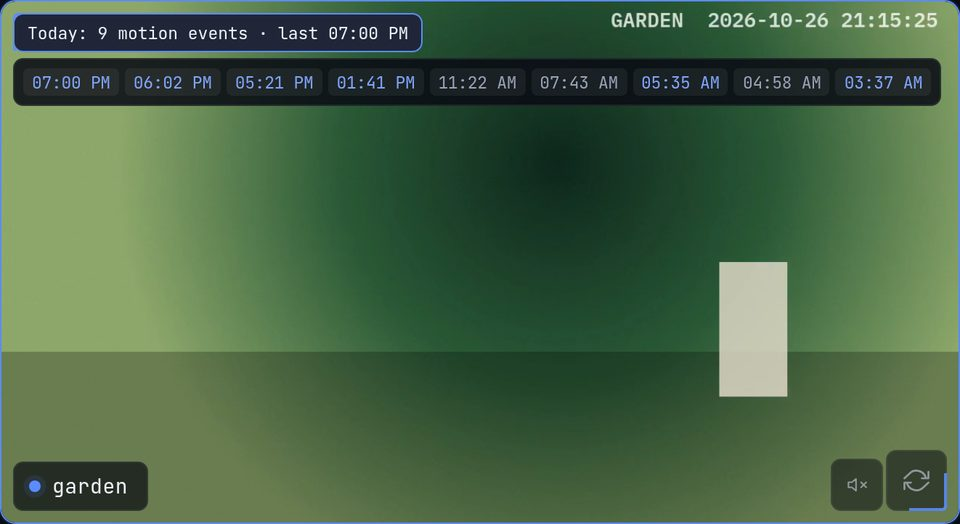
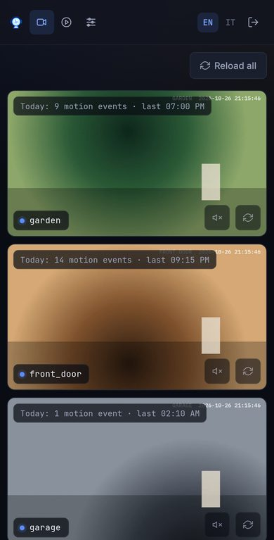

# yi-hack-cam-dashboard

A lightweight, self-hosted web dashboard for Yi / Kami cameras running
[yi-hack](https://github.com/roleoroleo) custom firmware. Built to run on a
Raspberry Pi next to the cameras.



<p>
  
  
</p>
<p>
  
  
</p>

<sub>Screenshots from a demo setup with synthetic camera feeds.</sub>

- **Live grid**: every camera at once, low-res substream in the grid and full-res when you
  expand a tile, audio on tap. Streams are remuxed by [MediaMTX](https://github.com/bluenviron/mediamtx),
  never transcoded, so a Pi copes easily.
- **Recordings**: browses the motion clips the cameras already upload over FTP, with
  thumbnails, a player with previous/next (arrow keys, swipe), "seen" marks and download.
- **Motion today**: each live tile shows today's motion count and last time; tap for the
  list, and a time with a matching clip opens it.
- **Real-time popups** in the browser on every motion event (MQTT → Server-Sent Events).
- **Notifications** to Telegram, ntfy and/or a generic webhook, with a snapshot.
- **Camera control**: on/off switch, online state, IP, WiFi signal, uptime and firmware.
- **English and Italian** interface, switchable per browser (EN/IT in the top bar).
- FastAPI + Jinja2 + HTMX: no Node, no build step, no database server (SQLite).

It uses what yi-hack already provides (RTSP, FTP upload of clips, MQTT motion events,
CGI endpoints), so it does not record or analyse video itself. If you want object
detection or continuous recording, look at Frigate, Scrypted or Shinobi instead.

## Requirements

- Cameras with yi-hack (tested with yi-hack-Allwinner and yi-hack-Allwinner-v2), with:
  - RTSP enabled. `RTSP_STREAM=both` gives the low-res substream for the grid. For live
    audio in the browser set `RTSP_AUDIO=aac`: browsers can't play PCM over HLS.
  - FTP upload of the motion clips to a folder the dashboard can read.
  - MQTT pointed at your broker (optional, but needed for motion popups, counters and notifications).
- Docker with Compose, on a Raspberry Pi 4/5 or any amd64/arm64 host.
- An MQTT broker (e.g. Mosquitto) and an FTP server, if you don't have them yet.

## Quick start

```bash
git clone https://github.com/aledv/yi-hack-cam-dashboard.git
cd yi-hack-cam-dashboard
cp .env.example .env
cp config.yml.example config.yml
cp mediamtx/mediamtx.yml.example mediamtx/mediamtx.yml
```

1. **Password hash and secret key**:
   ```bash
   pip install bcrypt
   python scripts/hash_password.py "your-password"
   python -c "import secrets; print(secrets.token_urlsafe(48))"
   ```
   Put the `$$`-escaped hash line in `ADMIN_PASSWORD_HASH` and the random string in
   `SECRET_KEY`. Docker Compose interpolates `$` inside `.env`, so a bcrypt hash pasted as-is
   gets corrupted: the script prints the escaped version for you.
2. **`.env`**: language, notification channels, MQTT broker, `RECORDINGS_DIR` (host folder
   with the clips). Every variable is explained in `.env.example`.
3. **`config.yml`**: one block per camera (RTSP URLs, recordings folder, on/off/status URLs,
   MQTT topic). See the comments in `config.yml.example`.
4. **`mediamtx/mediamtx.yml`**: one path per camera with the same `name` as in `config.yml`,
   plus `<name>_sub` for the substream.
5. Start it:
   ```bash
   docker compose up -d          # pulls ghcr.io/aledv/yi-hack-cam-dashboard
   docker compose up -d --build  # or build the image locally
   ```
   Open `http://<host>:8055`.

## Configuration

### Environment variables (`.env`)

Names only. See `.env.example` for details.

| Variable | Purpose |
|---|---|
| `ADMIN_USER`, `ADMIN_PASSWORD_HASH`, `SECRET_KEY` | Single-user login (bcrypt hash, cookie signing key) |
| `LANGUAGE` | Default interface language: `en` (default) or `it` |
| `TELEGRAM_BOT_TOKEN`, `TELEGRAM_CHAT_ID` | Telegram notifications |
| `NTFY_URL`, `NTFY_TOKEN` | ntfy notifications (token only for protected topics) |
| `WEBHOOK_URL` | Generic webhook: multipart POST with `message` and optional `file` |
| `MQTT_HOST`, `MQTT_PORT`, `MQTT_USER`, `MQTT_PASS` | MQTT broker for motion events |
| `MEDIAMTX_PUBLIC_BASE` | Base URL of MediaMTX as seen by the browser (reverse proxy / HTTPS) |
| `RECORDINGS_POLL_SECONDS` | Polling interval when recordings live on a network share |
| `RECORDINGS_DIR`, `APP_PORT` | Docker Compose only: clips folder on the host, published port |
| `CONFIG_PATH`, `DATA_DIR` | Only for running outside Docker (default `/app/config.yml`, `/app/data`) |

### Notifications

Every configured channel receives each notification: motion (with the latest clip's
thumbnail) and camera turned on/off. The **Notifications** checkbox on the Cameras page
turns them off per camera. The same page has a test button per channel and shows which
channels are configured and whether MQTT is connected.

### Language

`LANGUAGE` sets the default. Each browser can switch with **EN / IT** in the top bar or on
the login page, and the choice is kept in a cookie. Notifications sent from MQTT events
use the default language. To add a language, add its code to `LANGUAGES` and its texts
to `app/i18n.py`.

### Live view behind HTTPS

The Live page loads HLS straight from MediaMTX (port 8888). On a plain LAN that works out
of the box. If you serve the dashboard over HTTPS through a reverse proxy, also proxy
MediaMTX on its own hostname and set `MEDIAMTX_PUBLIC_BASE`, otherwise the browser blocks
the stream as mixed content. `mediamtx.yml.example` uses regular (not Low-Latency) HLS
because LL-HLS needs HTTPS on MediaMTX itself to work on iPhone/iPad.

## Security

This is meant for your LAN, or for remote access through a VPN (e.g. WireGuard). Auth is
deliberately simple: one user, bcrypt password, signed session cookie, no 2FA or rate
limiting. **Don't expose it directly to the internet.** yi-hack cameras themselves often
run with root and no password on the LAN.

## Development

```bash
cd app
python3 -m venv .venv && . .venv/bin/activate
pip install -r requirements.txt
CONFIG_PATH=../config.yml DATA_DIR=../data uvicorn main:app --reload --port 8055
```

`ffmpeg` is only needed for thumbnails. Start MediaMTX with `docker compose up -d mediamtx`
to get live video while developing.

### Tests and linter

```bash
cd app && python -m unittest discover -s tests -v   # tests
ruff check . && ruff format --check .               # Python linter (repo root)
hadolint --config .hadolint.yaml app/Dockerfile     # Dockerfile linter
```

Or, without a local Python setup:

```bash
cd app && docker run --rm -v "$PWD:/app" -w /app python:3.12-slim \
  sh -c "pip install -q -r requirements.txt && python -m unittest discover -s tests"
```

CI (`.github/workflows/image.yml`) runs the linters, then the tests. On `main` it also
publishes a multi-arch image (`linux/arm64`, `linux/amd64`) to GHCR.

## Project structure

```
app/
  main.py            FastAPI routes (pages, HTMX partials, SSE, language switch)
  config.py          config.yml loading with hot reload
  cameras.py         camera HTTP helpers (on/off, status, status.json)
  notifier.py        Telegram / ntfy / webhook notifications
  mqtt_listener.py   MQTT motion events -> popup, counters, notifications
  recordings.py      SQLite index of clips, thumbnails, motion events
  events.py          in-memory pub/sub for Server-Sent Events
  auth.py            single-user login
  i18n.py            English / Italian strings
  templates/         Jinja2 templates
  static/            CSS, icons, vendored htmx and hls.js
  tests/             unittest suite
mediamtx/            MediaMTX example config
scripts/             password hash helper
```

## Notes

- `config.yml` is reloaded automatically when it changes. Two exceptions need
  `docker compose restart`: new MQTT topics (`camera-app`) and new MediaMTX paths (`mediamtx`).
- Recordings are indexed in `data/recordings.db`. Thumbnails are generated on first view, and
  rows for deleted files are pruned at startup. Motion events are kept for 30 days.
- The Recordings page shows the last 2 days by default, 30 per page. Page 1 refreshes
  itself every 20 seconds.
- htmx and hls.js are bundled in `static/vendor/`, so the app works through a VPN without
  internet access. Only Google Fonts is external, and it falls back to system fonts.

## License

MIT, see [LICENSE](LICENSE). Bundled third-party code: [htmx](https://htmx.org) 1.9.12 (0BSD) and
[hls.js](https://github.com/video-dev/hls.js) 1.5.15 (Apache-2.0).
